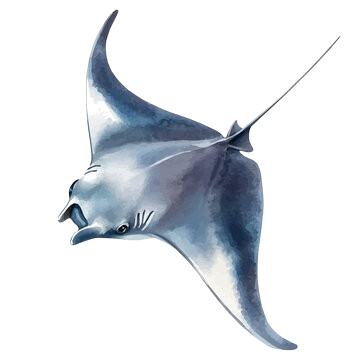

---
hide:
  - navigation
  - toc
---

<h1 class="or-hero__title">OceanRithm – Konzeptionelles Forschungsportal</h1>

OceanRithm ist ein forschungsorientiertes Framework, das sich auf die Weiterentwicklung von sicherem Workflow Governance, Multi Tenant Abstraktionsmodellen und Orchestrierungstheorie in modernen DevSecOps Ökosystemen konzentriert.

{ .or-hero__manta }

Dieses Portal bietet einen akademisch ausgerichteten, hochstrukturierten Überblick über die konzeptionellen Grundlagen von OceanRithm entwickelt für:

:material-school-outline: Akademische Begutachtung
:material-file-document-check-outline: Peer Review und Publikationsprozesse
:material-account-supervisor-outline: Wissenschaftliche Betreuung
:material-strategy: Strategische Architekturbewertung

OceanRithm abstrahiert bewusst Implementierungsdetails, Deployment Aspekte und infrastrukturabhängige Mechanismen, um konzeptionelle Klarheit und wissenschaftliche Integrität zu bewahren.  
Der Schwerpunkt liegt auf **Prinzipien, Governance Modellen, Identitätsgrenzen und sicherer Orchestrierungslogik**.

## **Umfang der Dokumentation**

-   :material-compass-outline:{ .lg .middle } **Hintergrund & Motivation**

    ---

    Eine strukturierte Analyse der Herausforderungen und Lücken in aktuellen sicheren Multi Tenant CI/CD Ökosystemen.

    [:octicons-arrow-right-24: Background](background.md)

-   :material-layers-triple-outline:{ .lg .middle } **Konzeptionelle Architektur**

    ---

    Eine schichtenbasierte Darstellung von Identitätsgovernance, Token Grenzen und Abstraktionen des Orchestrierungs Lebenszyklus.

    [:octicons-arrow-right-24: Conceptual Architecture](conceptual-architecture.md)

-   :material-shield-check-outline:{ .lg .middle } **Designprinzipien**

    ---

    Sicherheitsinvarianten, theoretische Rahmenbedingungen und zentrale Architekturannahmen, die OceanRithm leiten.

    [:octicons-arrow-right-24: Design Principles](design-principles.md)

-   :material-puzzle-outline:{ .lg .middle } **Funktionale & Nichtfunktionale Perspektiven**

    ---

    Eine konzeptionelle Übersicht über die primären funktionalen Rollen sowie nichtfunktionale Anforderungen des Modells.

    [:octicons-arrow-right-24: Functional Overview](functional-overview.md)  
    [:octicons-arrow-right-24: Non-Functional Concepts](non-functional.md)

-   :material-transit-connection-variant:{ .lg .middle } **Workflow Modelle**

    ---

    Illustrative Diagramme zu Credential Flows, Grenzdefinitionen und Governance Pfaden.

    [:octicons-arrow-right-24: Workflow Diagrams](workflow-diagrams.md)

-   :material-lightbulb-on-outline:{ .lg .middle } **Use Cases**

    ---

    Abstrakte Szenarien, die die Anwendung der OceanRithm Konzepte in Multi Tenant DevSecOps Umgebungen demonstrieren.

    [:octicons-arrow-right-24: Use Cases](use-cases.md)

-   :material-telescope:{ .lg .middle } **Limitierungen & Zukünftige Forschung**

    ---

    Dokumentierte konzeptionelle Grenzen und vorgeschlagene Erweiterungen für zukünftige Forschungsarbeiten.

    [:octicons-arrow-right-24: Limitations](limitations.md)  
    [:octicons-arrow-right-24: Future Work](future-work.md)

## **Wichtiger Hinweis**

Diese Dokumentation ist **konzeptionell und forschungsorientiert**.  
Sie enthält **keinen** Quellcode, keine Deployment Prozesse, keine operativen Abläufe und keine proprietären Implementierungsdetails.

Das konzeptionelle Framework von OceanRithm ist das geistige Eigentum von:

**OceanRithm Solutions UG (haftungsbeschränkt)**  
Berlin, Deutschland  

und wird ausschließlich für akademische, evaluative und forschungsbezogene Zwecke bereitgestellt.

Weitere Zusatzinformationen:  
[About](about.md)  
[Disclaimer](disclaimer.md)

