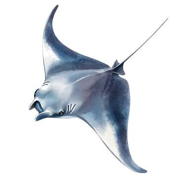

Conceptual Research Portal

<h1 class="or-hero__title">Secure orchestration, explained from first principles</h1>

OceanRithm is a research driven framework for secure workflow governance, multi tenant abstraction models and orchestration theory in modern DevSecOps ecosystems.

[Explore the architecture](conceptual-architecture.md){ .md-button .md-button--primary }
[Read the background](background.md){ .md-button }

{ .or-hero__manta }

## Who this portal is for

:material-school-outline: Academic evaluation
:material-file-document-check-outline: Peer review and publication
:material-account-supervisor-outline: Research supervision
:material-strategy: Architectural assessment

OceanRithm deliberately leaves out implementation, deployment and infrastructure details to keep the concepts clear and the research honest. The focus stays on **principles, governance, identity boundaries and secure orchestration logic**.

## Scope of the documentation

-   :material-compass-outline:{ .lg .middle } **Background & Motivation**

    ---

    The challenges and gaps in today's secure multi tenant CI/CD ecosystems.

    [:octicons-arrow-right-24: Background](background.md)

-   :material-layers-triple-outline:{ .lg .middle } **Conceptual Architecture**

    ---

    A layered view of identity governance, token boundaries and the orchestration lifecycle.

    [:octicons-arrow-right-24: Architecture](conceptual-architecture.md)

-   :material-shield-check-outline:{ .lg .middle } **Design Principles**

    ---

    Security invariants, theoretical constraints and the core assumptions behind the model.

    [:octicons-arrow-right-24: Design Principles](design-principles.md)

-   :material-puzzle-outline:{ .lg .middle } **Functional & Non Functional**

    ---

    The functional roles in the model and the conceptual constraints that shape it.

    [:octicons-arrow-right-24: Functional Overview](functional-overview.md)  
    [:octicons-arrow-right-24: Non-Functional Concepts](non-functional.md)

-   :material-transit-connection-variant:{ .lg .middle } **Workflow Models**

    ---

    Illustrative credential flows, boundary definitions and governance pathways.

    [:octicons-arrow-right-24: Workflow Diagrams](workflow-diagrams.md)

-   :material-lightbulb-on-outline:{ .lg .middle } **Use Cases**

    ---

    Abstract scenarios showing how the concepts apply to multi tenant DevSecOps.

    [:octicons-arrow-right-24: Use Cases](use-cases.md)

-   :material-telescope:{ .lg .middle } **Limitations & Future Research**

    ---

    Where the model currently stops and where the research goes next.

    [:octicons-arrow-right-24: Limitations](limitations.md)  
    [:octicons-arrow-right-24: Future Work](future-work.md)

-   :material-book-open-variant:{ .lg .middle } **Glossary & References**

    ---

    Key terms used across the portal and the literature it builds on.

    [:octicons-arrow-right-24: Glossary](glossary.md)  
    [:octicons-arrow-right-24: References](references.md)

!!! info "Important notice"

    This documentation is **conceptual and research focused**. It does **not** include source code, deployment procedures, operational workflows or proprietary implementation details.

    The OceanRithm conceptual framework is the intellectual work of **OceanRithm Solutions UG (haftungsbeschränkt)**, Berlin, Germany, and is provided exclusively for academic, evaluative and exploratory purposes.

    More information: [About](about.md) · [Disclaimer](disclaimer.md)
